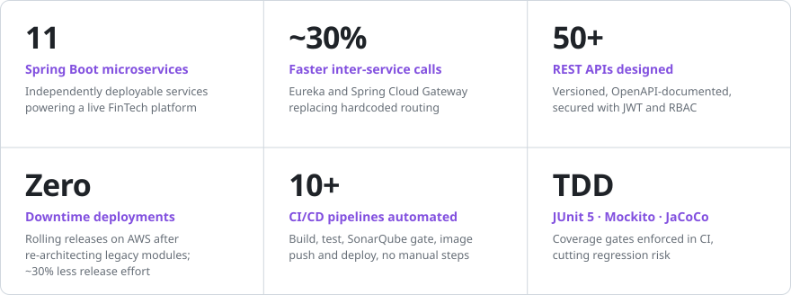
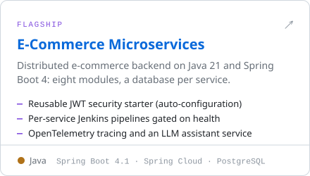
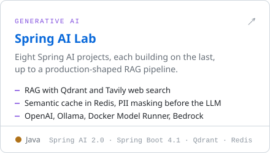
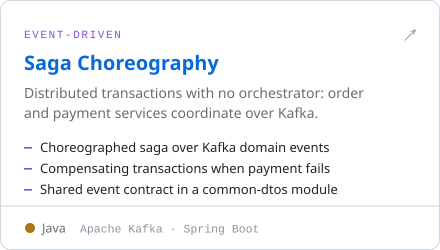
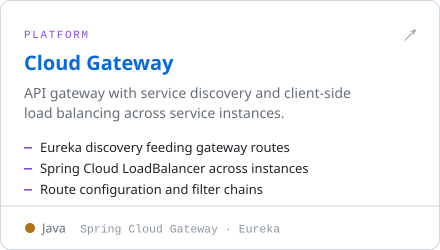
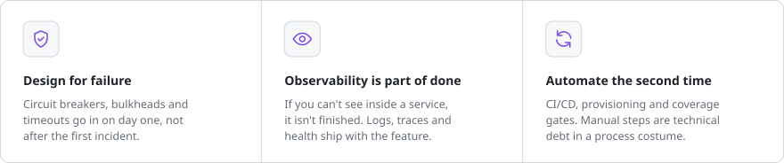

<!-- Graphics are generated by scripts/build_assets.py (light and dark variants). -->

<picture>
  <source media="(prefers-color-scheme: dark)" srcset="https://raw.githubusercontent.com/hayattarique/hayattarique/main/assets/hero-dark.svg" />
  
</picture>

<p align="center">
  <a href="mailto:hayattarique3@gmail.com">Email</a> &nbsp;·&nbsp;
  <a href="https://github.com/hayattarique/ecommerce-microservice">Flagship project</a> &nbsp;·&nbsp;
  <a href="https://github.com/hayattarique/spring-ai">Spring AI work</a> &nbsp;·&nbsp;
  <a href="#selected-work">Selected work</a> &nbsp;·&nbsp;
  <a href="#technology-arsenal">Technology</a>
</p>

## About


I build backend systems that stay up. Shipping Java services into production has made me
opinionated about a short list of things: **clear service boundaries**, **failure handled at the
edge before it cascades**, and **enough telemetry to answer "what broke?" in minutes rather than
hours**.

Lately that includes **LLM features on the JVM** with Spring AI and LangChain4j, where the same
rules apply: the model chooses a tool, and the service still enforces the permission.

- **Focus:** distributed systems, cloud-native delivery, generative AI on the JVM
- **Currently:** building high-throughput FinTech microservices, and an LLM assistant for my e-commerce platform
- **Looking for:** senior Java backend and cloud engineering roles in Hyderabad, Kolkata, Delhi or remote
- **Ask me about:** Kafka sagas, JWT at scale, distributed tracing, RAG

<br clear="right"/>

## Impact

<picture>
  <source media="(prefers-color-scheme: dark)" srcset="https://raw.githubusercontent.com/hayattarique/hayattarique/main/assets/impact-dark.svg" />
  
</picture>

In practice: Resilience4j circuit breakers and bulkheads to stop cascading failure, configuration
and credentials pulled from AWS Secrets Manager instead of committed properties, and distributed
tracing plus centralised logging so production incidents get diagnosed from evidence rather than
guesswork.

## Selected work

<p align="center">
  <a href="https://github.com/hayattarique/ecommerce-microservice"><picture><source media="(prefers-color-scheme: dark)" srcset="https://raw.githubusercontent.com/hayattarique/hayattarique/main/assets/projects/ecommerce-dark.svg" /></picture></a>
  <a href="https://github.com/hayattarique/spring-ai"><picture><source media="(prefers-color-scheme: dark)" srcset="https://raw.githubusercontent.com/hayattarique/hayattarique/main/assets/projects/spring-ai-dark.svg" /></picture></a>
</p>
<p align="center">
  <a href="https://github.com/hayattarique/saga-choreography"><picture><source media="(prefers-color-scheme: dark)" srcset="https://raw.githubusercontent.com/hayattarique/hayattarique/main/assets/projects/saga-dark.svg" /></picture></a>
  <a href="https://github.com/hayattarique/cloud-gateway"><picture><source media="(prefers-color-scheme: dark)" srcset="https://raw.githubusercontent.com/hayattarique/hayattarique/main/assets/projects/gateway-dark.svg" /></picture></a>
</p>

### Flagship architecture

<p align="center">
  <a href="https://github.com/hayattarique/ecommerce-microservice">
  <picture>
    <source media="(prefers-color-scheme: dark)" srcset="https://raw.githubusercontent.com/hayattarique/hayattarique/main/assets/architecture-dark.svg" />
    
  </picture>
  </a>
</p>

<details>
<summary><b>Inside the flagship: the decisions that define it</b></summary>

<br/>

| Decision | What it means |
|---|---|
| **A security starter, not a copied filter** | `utility-service` ships a real Spring Boot **auto-configuration**. A new service adds one dependency and inherits JWT validation, claim extraction and the auth entry point. Every bean is `@ConditionalOnMissingBean`, so a service overrides one without forking the library. |
| **Full token lifecycle** | HS256 access tokens (1 h) plus persisted refresh tokens (7 d) with **rotation, revocation and token-type separation**. A refresh token is rejected anywhere an access token is expected. |
| **Authorization with no network hop** | `users → roles → permissions` flattened into token claims, so every service authorizes locally. Refresh tokens deliberately omit them, so a permission change lands within one token lifetime. |
| **Defence in depth** | JWT verified at the gateway *and* again inside each service. A request that bypasses the edge is still fully protected. |
| **Traced, and deployed on evidence** | **OpenTelemetry** spans exported to **Jaeger 2.20**, and one **Jenkins** pipeline per service that fails the build unless **Actuator** reports the new instance `UP`. |
| **LLM tools call services, never databases** | In `ai-service`, the model picks a `@Tool`, and the call runs **under the caller's own JWT**. Permissions live in the services, not the prompt. |
| **Cluster-safe scheduled jobs** | Expired refresh tokens are purged by a `@Scheduled` job behind **ShedLock**, so with two instances only one runs it. |
| **Migrations own the schema** | Flyway-versioned SQL with `ddl-auto=none`, so entity/schema drift fails at startup instead of silently mutating a database. |

**Shipping model.** `main ← stage ← qa ← dev ← feature/*`, one branch per ticket, merged by PR
after review. All four environment branches exist in the repo.

**Where it stands.** Shipped: authentication, RBAC, health-gated CI/CD, tracing and ShedLock
scheduling. In progress: `ai-service` has LangChain4j and OpenAI wired in, with tools and agents
next; `product-service` is scaffolded. Planned: Testcontainers, Resilience4j, rate limiting,
Docker Compose, zero-downtime deploys, then cart, order and payment with Kafka and an outbox.

</details>

<details>
<summary><b>More repositories, one production concern each</b></summary>

<br/>

| Repository | Concern it isolates |
|---|---|
| [spring-cloud](https://github.com/hayattarique/spring-cloud) | Config Server serving multiple services, built by a committed Jenkinsfile |
| [circuitbreaker3.3.x](https://github.com/hayattarique/circuitbreaker3.3.x) | Spring Cloud Circuit Breaker against slow and unresponsive downstreams |
| [spring-security-jwt-h2-swagger](https://github.com/hayattarique/spring-security-jwt-h2-swagger) | Spring Security 6, stateless JWT, RBAC, documented end-to-end with OpenAPI |
| [spring-security-6.2.x](https://github.com/hayattarique/spring-security-6.2.x) | Spring Security 6.2 filter chain internals, built with Gradle |
| [feign-client](https://github.com/hayattarique/feign-client) | Declarative HTTP clients for typed inter-service calls |
| [spring-webflux](https://github.com/hayattarique/spring-webflux) | Reactive, non-blocking APIs with Project Reactor |
| [spring-batch](https://github.com/hayattarique/spring-batch) | Chunked batch processing, job orchestration and restartability |
| [junit-demo](https://github.com/hayattarique/junit-demo) | JUnit 5 and Mockito patterns underpinning the TDD workflow |
| [spring-boot-mutiple-db](https://github.com/hayattarique/spring-boot-mutiple-db) | Multiple datasources and transaction managers in one application |
| [voting-api](https://github.com/hayattarique/voting-api) | REST API built on the Gradle toolchain |
| [data-rest](https://github.com/hayattarique/data-rest) | Spring Data REST repository exposure and HAL responses |

</details>

## Generative AI

I bring LLM features into Java systems with the same engineering standards as any other service.

<p align="center">
  <a href="https://github.com/hayattarique/ecommerce-microservice/blob/dev/docs/ai-assistant.md">
  <picture>
    <source media="(prefers-color-scheme: dark)" srcset="https://raw.githubusercontent.com/hayattarique/hayattarique/main/assets/genai-flow-dark.svg" />
    
  </picture>
  </a>
</p>

- **[ai-service](https://github.com/hayattarique/ecommerce-microservice/blob/dev/docs/ai-assistant.md)** in the flagship uses **LangChain4j**
  tool calling. The model decides which microservice to call, and the call runs under the user's own
  JWT, so the assistant can never see data the user couldn't fetch themselves.
- **[spring-ai](https://github.com/hayattarique/spring-ai)** is a series of Spring AI builds:
  provider-agnostic `ChatClient` across OpenAI, Ollama, Docker Model Runner and Amazon Bedrock;
  prompt templates and advisors; structured output; chat memory in PostgreSQL; and RAG with Qdrant,
  a Redis semantic cache and PII masking.

## Technology Arsenal

<details open>
<summary><b>🤖 Generative AI &amp; LLMs</b></summary>
<br/>
<p>
  
  
  
  
  
  
  <br/>
  
  
  
  
  
  
</p>
</details>

<details open>
<summary><b>☕ Language &amp; Core</b></summary>
<br/>
<p>
  
  
  
  
  
  
  
  
  
  
  
</p>
</details>

<details open>
<summary><b>🔗 Distributed Systems &amp; Messaging</b></summary>
<br/>
<p>
  
  
  
  
  
  
  
</p>
</details>

<details open>
<summary><b>☁️ Cloud &amp; DevOps</b></summary>
<br/>
<p>
  
  
  
  
  
  
  
</p>
</details>

<details open>
<summary><b>🗄️ Databases &amp; Caching</b></summary>
<br/>
<p>
  
  
  
</p>
</details>

<details open>
<summary><b>🔍 Testing &amp; Observability</b></summary>
<br/>
<p>
  
  
  
  
  
  
</p>
</details>

<details>
<summary><b>🧰 Also worked with</b></summary>
<br/>
<p>
  
  
  
  
  
  
  
</p>
</details>

## GitHub Statistics

<p align="center">
  <picture>
    <source media="(prefers-color-scheme: dark)" srcset="https://github-stats-extended.vercel.app/api?username=hayattarique&show_icons=true&hide_rank=true&hide_border=true&custom_title=GitHub%20Stats&bg_color=0d1117&title_color=a78bfa&icon_color=a78bfa&text_color=c9d1d9" />
    
  </picture>
  &nbsp;
  <picture>
    <source media="(prefers-color-scheme: dark)" srcset="https://github-stats-extended.vercel.app/api/top-langs/?username=hayattarique&layout=compact&hide_border=true&langs_count=6&hide=html%2Ccss&exclude_repo=nextron&bg_color=0d1117&title_color=a78bfa&text_color=c9d1d9" />
    
  </picture>
</p>

<p align="center">
  <picture>
    <source media="(prefers-color-scheme: dark)" srcset="https://raw.githubusercontent.com/hayattarique/hayattarique/output/github-snake-dark.svg" />
    
  </picture>
</p>

## How I work

<p align="center">
  <picture>
    <source media="(prefers-color-scheme: dark)" srcset="https://raw.githubusercontent.com/hayattarique/hayattarique/main/assets/principles-dark.svg" />
    
  </picture>
</p>

<p align="center">
  <picture>
    <source media="(prefers-color-scheme: dark)" srcset="https://raw.githubusercontent.com/hayattarique/hayattarique/main/assets/pipeline-dark.svg" />
    
  </picture>
</p>

<details>
<summary><b>The delivery pipeline behind every service</b></summary>

<br/>

One declarative Jenkins pipeline per module, committed next to the code it deploys. It tests before
it packages, stops the old instance gracefully so it deregisters from Eureka, and fails the build
unless the new instance reports itself healthy. Full write-up:
[docs/ci-cd.md](https://github.com/hayattarique/ecommerce-microservice/blob/dev/docs/ci-cd.md).

```groovy
pipeline {
    agent any
    options {
        disableConcurrentBuilds()                       // two deploys must never race for one port
        buildDiscarder(logRotator(numToKeepStr: '15'))
    }
    environment {
        MODULE   = 'auth-service'
        APP_PORT = '9091'
        PROFILE  = 'dev'
    }
    stages {
        stage('Install parent POM')    { steps { dir('ecommerce-parent') { sh 'mvn -B -N clean install' } } }
        stage('Build utility-service') { steps { dir('utility-service')  { sh 'mvn -B clean install -DskipTests' } } }
        stage('Test')                  { steps { dir("${MODULE}")        { sh 'mvn -B clean test' } } }
        stage('Package')               { steps { dir("${MODULE}")        { sh 'mvn -B package -DskipTests' } } }

        stage('Stop old instance') {
            steps {
                sh 'pkill -f "$MODULE/target" || true'     // SIGTERM: deregister from Eureka, close the pool
                sh 'sleep 15'
                sh 'pkill -9 -f "$MODULE/target" || true'  // anything that ignored it would hold the port
            }
        }
        stage('Deploy jar') {
            steps {
                sh '''
                    JENKINS_NODE_COOKIE=dontKillMe nohup java -jar $WORKSPACE/$MODULE/target/*.jar \
                        --spring.profiles.active=$PROFILE --server.port=$APP_PORT > /tmp/$MODULE.log 2>&1 &
                '''
            }
        }
        stage('Health check') {
            steps {
                // A live JVM is not a working service: wait for Actuator to say UP, or fail with the logs
                sh 'curl -sf --retry 12 --retry-delay 5 --retry-connrefused http://localhost:$APP_PORT/actuator/health || { tail -n 100 /tmp/$MODULE.log; exit 1; }'
            }
        }
    }
}
```

</details>

## Contact

<p align="center">
  
</p>

<p align="center">
  <a href="mailto:hayattarique3@gmail.com">
  <picture>
    <source media="(prefers-color-scheme: dark)" srcset="https://raw.githubusercontent.com/hayattarique/hayattarique/main/assets/contact-dark.svg" />
    
  </picture>
  </a>
</p>

<p align="center"><sub>or copy it: <a href="mailto:hayattarique3@gmail.com">hayattarique3@gmail.com</a></sub></p>
